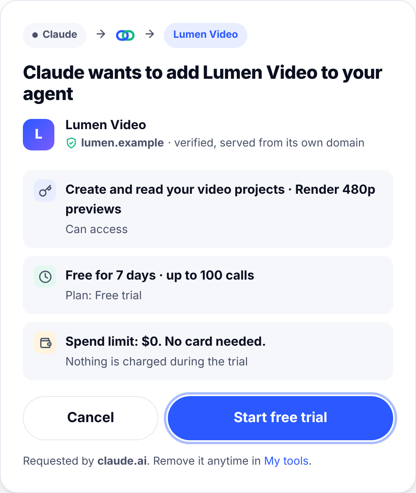
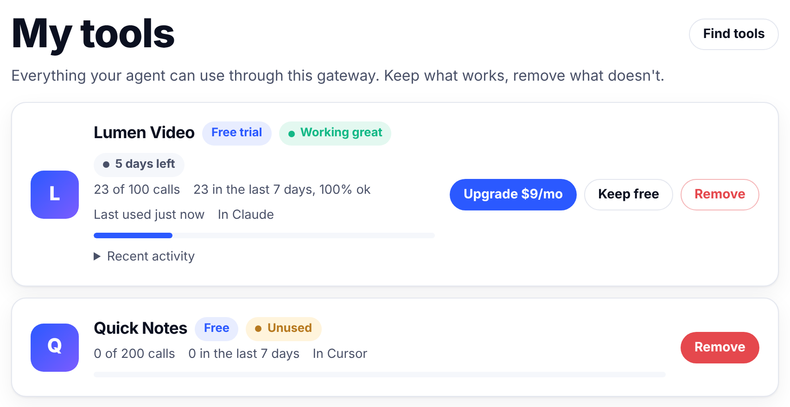
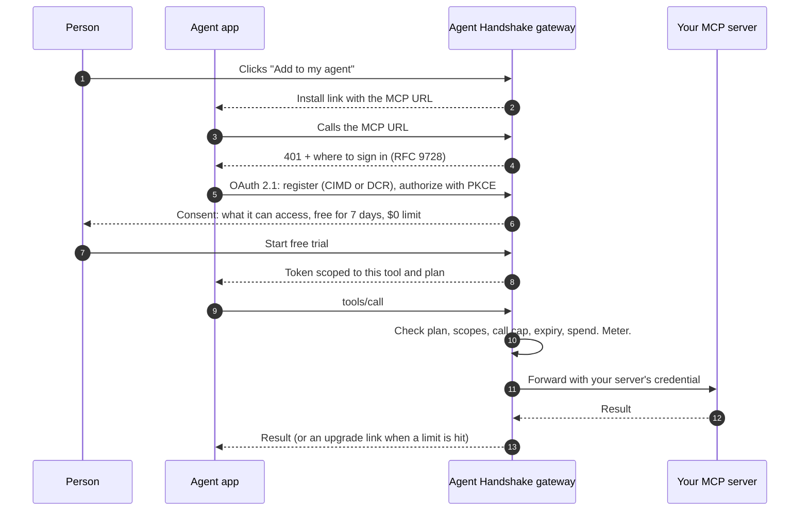

<p align="center">
  
</p>

<h3 align="center">Add to my agent. Three clicks, zero pasting.</h3>

<p align="center">
  <code>npm install</code> for agents, with a free trial, a wallet, and an uninstall button.
</p>

<p align="center">
  <a href="LICENSE"></a>
  
  
  
</p>

---

Today, giving an AI agent a new tool usually means pasting a block of markdown or an API key into it. There's no identity, no trial, no billing, no versioning and no clean way to remove it.

**Agent Handshake** replaces that with a handshake. Put the gateway in front of any remote [MCP](https://modelcontextprotocol.io) server and you get:

1. **Click one button.** An *Add to my agent* button on any website opens the right install link for Claude, Claude Code, Cursor, VS Code, Goose, LM Studio or ChatGPT. There's nothing to copy.
2. **Read three lines, start the trial.** A consent screen shows what the tool can access, how long it's free, and the spend limit ($0 by default). Then **Start free trial**.
3. **Keep it, pay for it, or remove it.** Every call is metered. *My tools* shows what's working and what's unused, with **Upgrade**, **Keep free** and **Remove** buttons. Removing revokes access at once.

It's built on standards that already exist: MCP, OAuth 2.1, MCP Server Cards, the AI Catalog and x402. Agent Handshake adds the missing layer: **trials, metering, keep/drop signals and spend limits.**

<p align="center">
  
  &nbsp;
  
</p>

## Try it in 60 seconds

You need [Node.js 20+](https://nodejs.org). No install step and no dependencies.

```bash
npx github:larvuz2/agent-handshake demo
```

Or clone it:

```bash
git clone https://github.com/larvuz2/agent-handshake && cd agent-handshake
npm run demo
```

This starts the gateway on `http://localhost:7410` with two demo tools, **Lumen Video** (fictional video maker with a 7-day trial and a $9/mo Pro plan) and **Quick Notes** (free). Payments run in test mode.

Then:

1. Open **http://localhost:7410/add/lumen-video** and pick your agent app.
2. In **Claude Code**, for example:
   ```bash
   claude mcp add --transport http lumen-video http://localhost:7410/mcp/lumen-video
   ```
   Run `/mcp`, choose **lumen-video**, then **Authenticate**. Your browser shows the free-trial screen. Click **Start free trial**.
3. Ask your agent: *"Make a 15-second video project about a sunrise over a lake, then render a preview."*
4. Ask: *"Render it in 4K."* The 4K render is a Pro feature, so the agent gets an upgrade link.
5. Ask: *"What's my Lumen Video plan?"* The built-in `handshake_status` tool answers with days left, calls used and links.
6. Open **http://localhost:7410/my** to upgrade (simulated checkout), switch to the free plan, or remove the tool.
7. Open **http://localhost:7410/admin** with the admin key printed at startup to see the publisher dashboard.

Cursor, VS Code, Goose and LM Studio on the same computer work with `localhost` too. For **claude.ai** or **ChatGPT**, the gateway needs a public HTTPS URL. See [Deploy](docs/deploy.md).

## Put your MCP server behind it

```bash
npx github:larvuz2/agent-handshake init       # asks 9 questions, writes handshake.config.json
npx github:larvuz2/agent-handshake validate   # checks the config and that your server answers
npx github:larvuz2/agent-handshake start      # runs the gateway
```

A minimal config:

```json
{
  "services": [
    {
      "id": "lumen-video",
      "name": "com.lumenvideo/mcp",
      "title": "Lumen Video",
      "description": "Turn a prompt into a short video.",
      "publisher": { "name": "Lumen Labs", "domain": "lumenvideo.com" },
      "upstream": {
        "url": "https://internal.lumenvideo.com/mcp",
        "headers": { "Authorization": "Bearer ${env:LUMEN_API_KEY}" }
      },
      "scopes": {
        "projects": { "description": "Create and read your video projects", "tools": ["list_projects", "create_project"] },
        "render:full": { "description": "Render full-quality 4K videos", "tools": ["render_full"] }
      },
      "plans": [
        { "id": "trial", "price": 0, "durationDays": 7, "limits": { "calls": 100 }, "scopes": ["projects"] },
        { "id": "pro", "price": { "amount": 9, "currency": "USD", "interval": "month" }, "scopes": ["projects", "render:full"] }
      ]
    }
  ]
}
```

Your MCP server doesn't change. The gateway calls it with your own credential and adds `X-Handshake-User`, `X-Handshake-Plan` and `X-Handshake-Scopes` headers, so you can serve per-person data.

Then add the button to your site:

```html
<script src="https://your-gateway.example/button.js" data-service="lumen-video" async></script>
```

Or put a badge in your README:

```markdown
[](https://your-gateway.example/add/lumen-video)
```

See the [publisher guide](docs/publishers.md) for scopes, plans, payments and the publisher API.

## How it works



| Piece | What it does |
|---|---|
| **Discovery** | Publishes an [MCP Server Card](https://modelcontextprotocol.io/seps/2127-mcp-server-cards) per tool (`/mcp/<id>/server-card`), an [AI Catalog](https://ai-catalog.io/spec/) (`/.well-known/ai-catalog.json`) and `llms.txt`. Trial and pricing terms ride along in the card's `_meta["dev.handshake/terms"]`. |
| **Install page** | `/add/<id>`: the three-line summary plus the right install link for each agent app. |
| **OAuth 2.1** | Protected Resource Metadata, Client ID Metadata Documents and Dynamic Client Registration, PKCE S256, resource indicators, `iss`, refresh rotation, revocation. The consent screen *is* the trial screen. |
| **Entitlements** | Trial, active, expired or removed. Scopes decide which tools a plan includes; caps, expiry and spend limits are checked on every call. |
| **MCP proxy** | Works with session-based (2025-06-18, 2025-11-25) and stateless (2026-07-28) clients, JSON or streamed responses. Hides tools a plan doesn't include and adds a `handshake_status` tool. |
| **Upgrade prompts** | When a limit is hit, apps that support it get a URL-mode elicitation (the `-32042` error or an `input_required` result). Everyone else gets a clear message with links. |
| **Payments** | Stripe Checkout (subscriptions), a simulated test mode, your own checkout via the publisher API, or **x402** pay-per-call in USDC, checked against the person's spending limits. |
| **My tools** | Keep/drop labels from real usage (*Working great*, *Try more*, *Unused*, *Expensive*, *Having trouble*), recent activity, upgrade, keep free, remove, spending limits. |
| **Publisher dashboard** | Installs, trials, conversions, calls, payments, share links, and per-install actions. Plus a JSON API. |
| **Host kit** | `agent-handshake/host` for agent apps (Hermes first): discovery, consent summary, tool pinning, local usage ledger, labels, spend policy, revocation. |

## Works with

| App | How |
|---|---|
| Claude (claude.ai, Desktop, mobile) | Install link opens *Add custom connector*. Needs a public HTTPS gateway. |
| Claude Code | `claude mcp add --transport http <id> <url>` |
| Cursor | `cursor://` install link |
| VS Code (Copilot agent mode) | `vscode:mcp/install` link or `code --add-mcp` |
| Goose | `goose://extension` link |
| LM Studio | `lmstudio://add_mcp` link |
| ChatGPT (developer mode) | Paste the URL. Needs a public HTTPS gateway. |
| Anything else with remote MCP + OAuth | Paste the URL |

Tested in CI against the official [MCP TypeScript SDK](https://github.com/modelcontextprotocol/typescript-sdk) client.

## The terms extension

Agent Handshake doesn't invent a new manifest. It adds one namespaced key to the MCP Server Card:

```json
"_meta": {
  "dev.handshake/terms": {
    "specVersion": "0.1",
    "defaultPlan": "trial",
    "scopes": { "projects": { "description": "Create and read your video projects" } },
    "plans": [
      { "id": "trial", "title": "Free trial", "price": 0, "durationDays": 7, "limits": { "calls": 100, "spendUsd": 0 }, "scopes": ["projects"] },
      { "id": "pro", "title": "Pro", "price": { "amount": 9, "currency": "USD", "interval": "month" }, "scopes": ["projects", "render:full"] }
    ],
    "uninstall": { "revocationEndpoint": "https://gateway.example/oauth/revoke" }
  }
}
```

Any agent app can read it and show the same three lines. Read the [spec](spec/SPEC.md).

## Go live

1. Deploy the gateway with Docker, Fly.io, Render or Railway. See [docs/deploy.md](docs/deploy.md).
2. Set `PUBLIC_URL` to its HTTPS address.
3. For real payments, set `STRIPE_SECRET_KEY` and `STRIPE_WEBHOOK_SECRET`.
4. Put the button on your site.

## Docs

- [Publisher guide](docs/publishers.md): config, scopes, plans, payments, button, publisher API
- [Agent apps and the host kit](docs/hosts.md): install links per app, building native support
- [Deploy](docs/deploy.md): Docker, Fly.io, Render, Railway, tunnels, Stripe, x402
- [Security](docs/security.md): threat model and controls
- [Architecture](docs/architecture.md): components, data model, protocol details
- [Spec](spec/SPEC.md): `dev.handshake/terms`, install links, gateway API
- [Brand](brand/BRAND.md): logo, colors, the button
- [Plan](docs/PLAN.md): the analysis and decisions behind v0.1

## Project layout

```
bin/            CLI: demo, init, start, validate, links, card
src/            the gateway (no dependencies)
  oauth/        authorization server
  mcp/          MCP proxy, upgrade messages, SSE handling
  billing/      Stripe, test mode, x402
  pages/        install, consent, My tools, upgrade, publisher dashboard
host/           host kit for agent apps
spec/           terms extension spec and JSON Schemas
brand/          logo, colors, CSS
examples/demo/  two demo MCP servers
site/           project website (GitHub Pages)
test/           end-to-end, unit and SDK interop tests
```

## Development

```bash
npm test               # end-to-end and unit tests, no dependencies needed
npm install && npm run test:interop   # also run the official MCP SDK client against the gateway
```

## Status and roadmap

v0.1 is a working, single-instance gateway. Next:

- Postgres store for running more than one instance
- Email or passkey sign-in, so *My tools* follows you across devices
- x402 on mainnet with a production facilitator
- Native support for the terms in agent apps, starting with Hermes
- Proposing `dev.handshake/terms` to the MCP Server Card and AI Catalog groups
- Opt-in, aggregated reputation signals across gateways

## License

[MIT](LICENSE). Contributions welcome: see [CONTRIBUTING.md](CONTRIBUTING.md).
