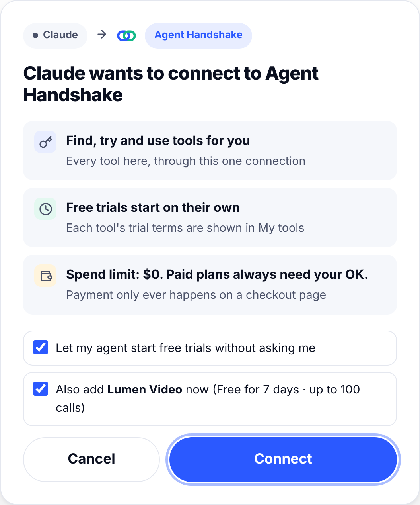
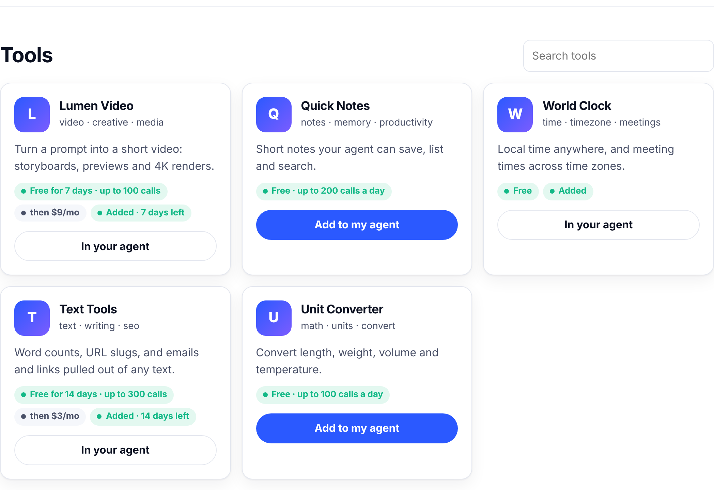
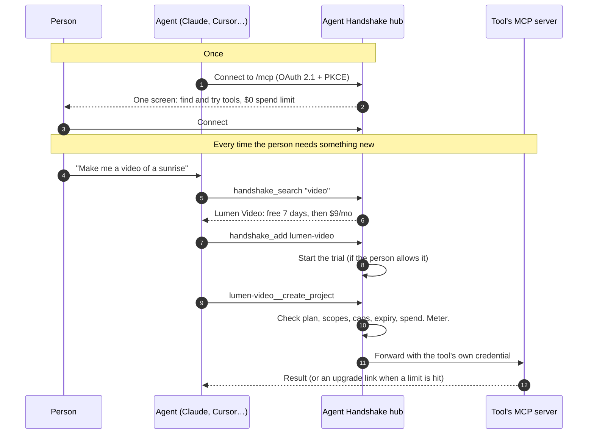

<p align="center">
  
</p>

<h3 align="center">The open agent aggregator. Every tool for your agent, one handshake.</h3>

<p align="center">
  Connect your agent once. It finds, tries and uses tools by itself,<br>with free trials, spend limits and one place to manage everything.
</p>

<p align="center">
  <a href="LICENSE"></a>
  
  
  
</p>

---

Today, giving an AI agent a new ability means pasting instructions or an API key into it, one tool at a time. There's no identity, no trial, no billing and no clean way to remove anything.

**Agent Handshake** is one front door to every tool:

- **For people:** connect your agent (Claude, Cursor, VS Code…) to an Agent Handshake hub **once**. Then add any tool with one click, or just ask your agent. Free trials start at a $0 spend limit, and *My tools* shows what's working, with **Upgrade** and **Remove** buttons.
- **For agents:** one MCP connection with seven tools: `handshake_search`, `handshake_add`, `handshake_call`, `handshake_tool_info`, `handshake_my_tools`, `handshake_upgrade`, `handshake_remove`. When the person asks for something new, the agent finds a tool, starts its trial and uses it. Added tools also appear natively as `tool__action`.
- **For tool makers:** put your MCP server behind the hub and every connected agent can find it, try it and pay for it. Your server doesn't change.

It is **an open protocol and an open-source product**. The protocol builds on MCP, OAuth 2.1, Server Cards, the AI Catalog and x402, and adds the missing layer: trial and price terms, one install link, entitlements and spend limits. The product is the hub that anyone can run, and that you can host as the flagship.

<p align="center">
  
  &nbsp;
  
</p>

- The user experience on one page, screen by screen: [user-experience.pdf](docs/user-experience.pdf)
- Why this is a company, and how it gets users: [PITCH.md](docs/PITCH.md)

## Try it in 60 seconds

You need [Node.js 20+](https://nodejs.org). No install step and no dependencies.

```bash
npx github:larvuz2/agent-handshake demo
```

Or clone it:

```bash
git clone https://github.com/larvuz2/agent-handshake && cd agent-handshake
npm run demo
```

This starts a hub on `http://localhost:7410` with five demo tools: **Lumen Video** (fictional video maker: 7-day trial, then $9/mo), **Quick Notes**, **World Clock**, **Text Tools** and **Unit Converter**. Payments run in test mode.

Then connect your agent **once**. With **Claude Code**, for example:

```bash
claude mcp add --transport http agent-handshake http://localhost:7410/mcp
```

Run `/mcp`, choose **agent-handshake**, then **Authenticate**. Your browser shows one screen: click **Connect**. Now ask your agent things it couldn't do before:

1. *"What time is it in Tokyo?"* The agent searches the hub, adds **World Clock** and answers.
2. *"Make a 15-second video of a sunrise over a lake."* It adds **Lumen Video** (free trial) and makes the project.
3. *"Render it in 4K."* That's a Pro feature, so the agent gives you an upgrade link (simulated checkout in test mode).
4. *"Show my tools."* You get your tools, usage, and a link to **My tools**.

You can also browse **http://localhost:7410** and click **Add to my agent** on any tool, or open **/admin** (admin key printed at startup) for the publisher dashboard.

Cursor, VS Code, Goose and LM Studio on the same computer work with `localhost` too. For **claude.ai** or **ChatGPT**, the hub needs a public HTTPS URL. See [Deploy](docs/deploy.md).

## Put your MCP server behind it

```bash
npx github:larvuz2/agent-handshake init       # asks 9 questions, writes handshake.config.json
npx github:larvuz2/agent-handshake validate   # checks the config and that your server answers
npx github:larvuz2/agent-handshake start      # runs the gateway
```

A minimal config:

```json
{
  "services": [
    {
      "id": "lumen-video",
      "name": "com.lumenvideo/mcp",
      "title": "Lumen Video",
      "description": "Turn a prompt into a short video.",
      "publisher": { "name": "Lumen Labs", "domain": "lumenvideo.com" },
      "upstream": {
        "url": "https://internal.lumenvideo.com/mcp",
        "headers": { "Authorization": "Bearer ${env:LUMEN_API_KEY}" }
      },
      "scopes": {
        "projects": { "description": "Create and read your video projects", "tools": ["list_projects", "create_project"] },
        "render:full": { "description": "Render full-quality 4K videos", "tools": ["render_full"] }
      },
      "plans": [
        { "id": "trial", "price": 0, "durationDays": 7, "limits": { "calls": 100 }, "scopes": ["projects"] },
        { "id": "pro", "price": { "amount": 9, "currency": "USD", "interval": "month" }, "scopes": ["projects", "render:full"] }
      ]
    }
  ]
}
```

Your MCP server doesn't change. The gateway calls it with your own credential and adds `X-Handshake-User`, `X-Handshake-Plan` and `X-Handshake-Scopes` headers, so you can serve per-person data.

Then add the button to your site:

```html
<script src="https://your-gateway.example/button.js" data-service="lumen-video" async></script>
```

Or put a badge in your README:

```markdown
[](https://your-gateway.example/add/lumen-video)
```

See the [publisher guide](docs/publishers.md) for scopes, plans, payments and the publisher API.

## How it works



| Piece | What it does |
|---|---|
| **Discovery** | Publishes a hub [Server Card](https://modelcontextprotocol.io/seps/2127-mcp-server-cards) (`/mcp/server-card`) and one per tool, an [AI Catalog](https://ai-catalog.io/spec/) that lists the hub first, and an `llms.txt` and `/agents` page written for agents. Trial and pricing terms ride along in each card's `_meta["dev.handshake/terms"]`. |
| **Hub** | `/mcp`: one MCP connection with seven agent tools. Added tools appear as `tool__action`, each checked and metered against its own plan. Sends `tools/list_changed` so apps refresh. |
| **Storefront and one-click add** | `/` lists every tool; `/connect` connects an agent once; `/add/<id>` (the button on a tool's website) brings that tool along on first connect, and is one click after that. |
| **Install page** | Each tool can still be added on its own as a separate connector, with the right install link for each agent app. |
| **OAuth 2.1** | Protected Resource Metadata, Client ID Metadata Documents and Dynamic Client Registration, PKCE S256, resource indicators, `iss`, refresh rotation, revocation. The consent screen *is* the trial screen. |
| **Entitlements** | Trial, active, expired or removed. Scopes decide which tools a plan includes; caps, expiry and spend limits are checked on every call. |
| **MCP proxy** | For direct, per-tool connections. Works with session-based (2025-06-18, 2025-11-25) and stateless (2026-07-28) clients, JSON or streamed responses. Hides tools a plan doesn't include and adds a `handshake_status` tool. |
| **Upgrade prompts** | When a limit is hit, apps that support it get a URL-mode elicitation (the `-32042` error or an `input_required` result). Everyone else gets a clear message with links. |
| **Payments** | Stripe Checkout (subscriptions), a simulated test mode, your own checkout via the publisher API, or **x402** pay-per-call in USDC, checked against the person's spending limits. |
| **My tools** | Keep/drop labels from real usage (*Working great*, *Try more*, *Unused*, *Expensive*, *Having trouble*), recent activity, upgrade, keep free, remove, spending limits. |
| **Publisher dashboard** | Installs, trials, conversions, calls, payments, share links, and per-install actions. Plus a JSON API. |
| **Host kit** | `agent-handshake/host` for agent apps (Hermes first): discovery, consent summary, tool pinning, local usage ledger, labels, spend policy, revocation. |

## Works with

| App | How |
|---|---|
| Claude (claude.ai, Desktop, mobile) | Install link opens *Add custom connector*. Needs a public HTTPS gateway. |
| Claude Code | `claude mcp add --transport http <id> <url>` |
| Cursor | `cursor://` install link |
| VS Code (Copilot agent mode) | `vscode:mcp/install` link or `code --add-mcp` |
| Goose | `goose://extension` link |
| LM Studio | `lmstudio://add_mcp` link |
| ChatGPT (developer mode) | Paste the URL. Needs a public HTTPS gateway. |
| Anything else with remote MCP + OAuth | Paste the URL |

Tested in CI against the official [MCP TypeScript SDK](https://github.com/modelcontextprotocol/typescript-sdk) client.

## The terms extension

Agent Handshake doesn't invent a new manifest. It adds one namespaced key to the MCP Server Card:

```json
"_meta": {
  "dev.handshake/terms": {
    "specVersion": "0.1",
    "defaultPlan": "trial",
    "scopes": { "projects": { "description": "Create and read your video projects" } },
    "plans": [
      { "id": "trial", "title": "Free trial", "price": 0, "durationDays": 7, "limits": { "calls": 100, "spendUsd": 0 }, "scopes": ["projects"] },
      { "id": "pro", "title": "Pro", "price": { "amount": 9, "currency": "USD", "interval": "month" }, "scopes": ["projects", "render:full"] }
    ],
    "uninstall": { "revocationEndpoint": "https://gateway.example/oauth/revoke" }
  }
}
```

Any agent app can read it and show the same three lines. Read the [spec](spec/SPEC.md).

## Go live

1. Deploy the gateway with Docker, Fly.io, Render or Railway. See [docs/deploy.md](docs/deploy.md).
2. Set `PUBLIC_URL` to its HTTPS address.
3. For real payments, set `STRIPE_SECRET_KEY` and `STRIPE_WEBHOOK_SECRET`.
4. Put the button on your site.

## Website

The landing page lives in [`site/`](site/). To publish it on **Netlify**, connect this repo: [`netlify.toml`](netlify.toml) already sets the build (`node scripts/build-site.js`) and the output folder (`site/dist`). No dependencies to install. Preview it locally with `npm run site` and open `site/dist/index.html` through any static server.

## Docs

- [The user experience, screen by screen](docs/user-experience.pdf) (one-page PDF; [single-tool version](docs/user-experience-single-tool.pdf))
- [The pitch: business model and go-to-market](docs/PITCH.md), and the [pitch deck (PDF)](docs/pitch-deck.pdf)
- [Publisher guide](docs/publishers.md): config, scopes, plans, payments, button, publisher API
- [Agent apps and the host kit](docs/hosts.md): install links per app, building native support
- [Deploy](docs/deploy.md): Docker, Fly.io, Render, Railway, tunnels, Stripe, x402
- [Security](docs/security.md): threat model and controls
- [Architecture](docs/architecture.md): components, data model, protocol details
- [Spec](spec/SPEC.md): `dev.handshake/terms`, install links, gateway API
- [Brand](brand/BRAND.md): logo, colors, the button
- [Plan](docs/PLAN.md): the analysis and decisions behind v0.1

## Project layout

```
bin/            CLI: demo, init, start, validate, links, card
src/            the gateway (no dependencies)
  oauth/        authorization server
  mcp/          MCP proxy, upgrade messages, SSE handling
  billing/      Stripe, test mode, x402
  pages/        install, consent, My tools, upgrade, publisher dashboard
host/           host kit for agent apps
spec/           terms extension spec and JSON Schemas
brand/          logo, colors, CSS
examples/demo/  two demo MCP servers
site/           project website (GitHub Pages)
test/           end-to-end, unit and SDK interop tests
```

## Development

```bash
npm test               # end-to-end and unit tests, no dependencies needed
npm install && npm run test:interop   # also run the official MCP SDK client against the gateway
```

## Status and roadmap

v0.2 is a working, single-instance hub. Next:

- **Federation:** one hub listing tools hosted on other Agent Handshake gateways, so the catalog can grow without central hosting
- **A public catalog repo:** tool makers list their MCP server with a pull request
- Postgres store for running more than one instance
- Email or passkey sign-in, so *My tools* follows you across devices
- Reputation from real usage across hubs (opt-in, aggregated) to rank search results
- x402 on mainnet with a production facilitator
- Proposing `dev.handshake/terms` and `dev.handshake/hub` to the MCP Server Card and AI Catalog groups

## License

[MIT](LICENSE). Contributions welcome: see [CONTRIBUTING.md](CONTRIBUTING.md).
